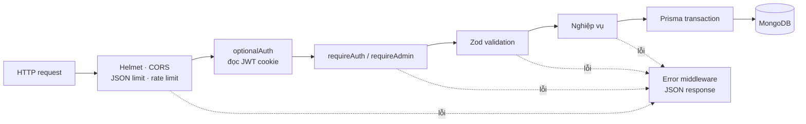
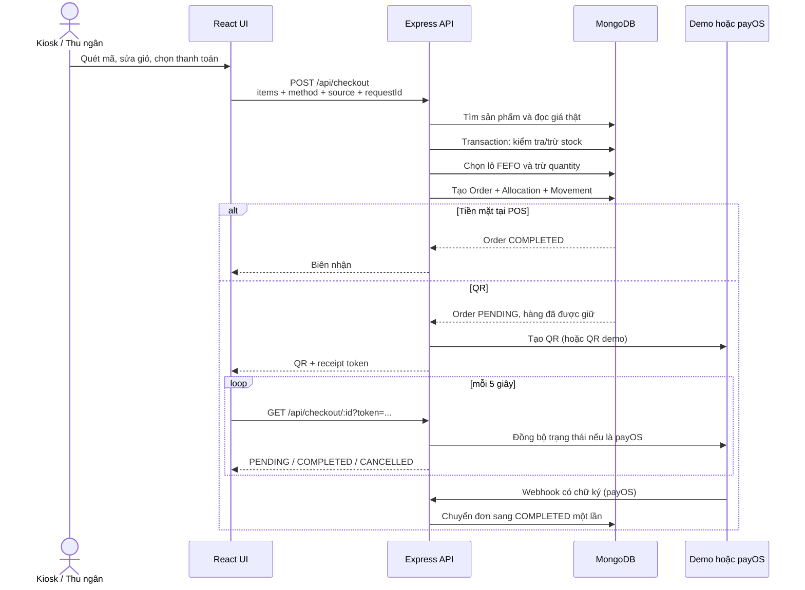
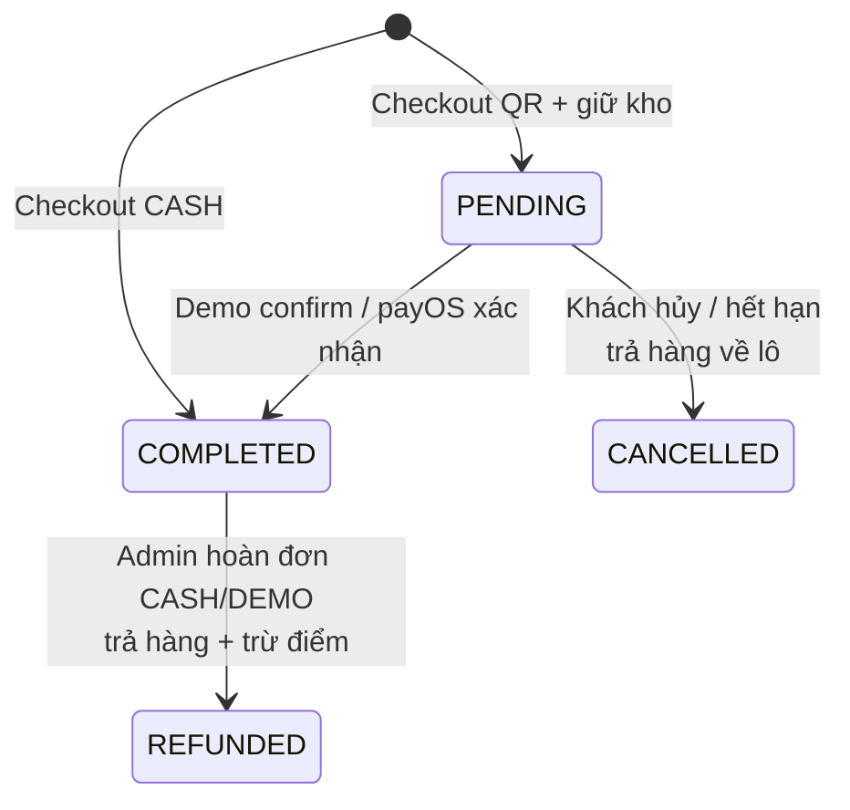
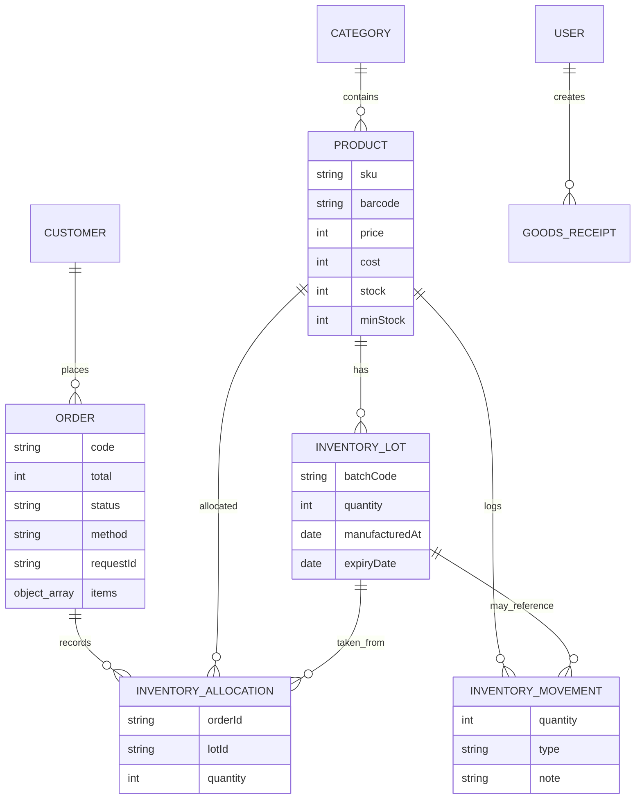

# Kiến trúc EasyRetail / NEU SelfPOS

Tài liệu này giải thích hệ thống đang được chia thành những phần nào, dữ liệu đi
qua đâu, và vai trò của các file chính. Mục tiêu là giúp một người mới mở project
có thể biết nên đọc từ đâu và sửa ở đâu.

## 1. Nhìn nhanh trong 30 giây

Đây là một **modular monolith** được đóng gói thành ba container, không phải hệ
thống microservice:

- `web`: Next.js + React, hiển thị giao diện quản trị, POS và kiosk.
- `api`: Express + Prisma, giữ toàn bộ luật nghiệp vụ và quyền truy cập.
- `mongo`: MongoDB replica set, lưu dữ liệu và hỗ trợ transaction.

Trình duyệt chỉ mở cổng của `web`. Các URL `/api/*` và `/uploads/*` được Next.js
chuyển tiếp nội bộ sang `api`; MongoDB và API không mở cổng trực tiếp ra máy host.

```mermaid
flowchart LR
    Actor[Khách hàng / Nhân viên / Admin]

    subgraph Browser[Trình duyệt]
        UI[React UI<br/>Dashboard · POS · Kiosk · Quản lý]
        Client[api() / mutate()<br/>HTTP client dùng chung]
        UI --> Client
    end

    subgraph Docker[Docker Compose]
        Web[Next.js :3000<br/>UI + reverse proxy]
        API[Express :4000<br/>Auth + nghiệp vụ + validation]
        DB[(MongoDB :27017<br/>replica set)]
        Uploads[(Volume ảnh sản phẩm)]
        Web -->|/api/*| API
        Web -->|/uploads/*| API
        API -->|Prisma| DB
        API --> Uploads
    end

    PayOS[payOS<br/>tùy chọn]
    Gemini[Gemini API<br/>tùy chọn]

    Actor --> UI
    Client -->|HTTP cùng origin| Web
    API <-->|QR + webhook| PayOS
    API -->|Cố vấn kinh doanh| Gemini
```

Ý chính: **frontend không được tự quyết định giá tiền hay tồn kho**. Nó chỉ gửi
`productId` và số lượng. API đọc giá hiện tại từ database, kiểm tra tồn, chọn lô,
tính tổng và ghi tất cả thay đổi trong transaction.

## 2. Cấu trúc thư mục

```text
NEUselfPOS/
├── docker-compose.yml             # Ghép web, api, mongo và volume
├── package.json                   # Lệnh chạy/test ở cấp project
├── apps/
│   ├── web/
│   │   ├── src/app/               # Next.js entry, layout và CSS toàn cục
│   │   ├── src/components/        # Các màn hình và component React
│   │   ├── src/lib/api.ts         # Type dùng ở UI + HTTP client
│   │   ├── next.config.mjs        # Reverse proxy sang API
│   │   └── Dockerfile             # Build Next.js standalone
│   └── api/
│       ├── src/server.ts           # Express app + phần lớn REST endpoint
│       ├── src/orders.ts           # Checkout, thanh toán, hủy, hoàn đơn
│       ├── src/inventory.ts        # FEFO, tồn khả dụng, hạn sử dụng
│       ├── src/auth.ts             # JWT cookie + kiểm tra role
│       ├── src/validation.ts       # Zod schema cho input
│       ├── src/db.ts               # Prisma client + transaction retry
│       ├── src/payos.ts            # Adapter giao tiếp payOS
│       ├── src/gemini.ts           # Endpoint cố vấn dùng Gemini
│       ├── prisma/schema.prisma    # Mô hình dữ liệu
│       ├── prisma/seed.ts          # Dữ liệu demo
│       └── docker-entrypoint.sh    # Push schema, seed, rồi chạy API
├── tests/
│   ├── api-contract.mjs           # Test API, quyền, transaction, idempotency
│   └── browser.mjs                # Test luồng thật bằng Playwright
└── docs/                           # Tài liệu, use case, bằng chứng kiểm thử
```

## 3. Frontend hoạt động thế nào

### Điều hướng

`src/app/page.tsx` và route bắt tất cả `src/app/[...page]/page.tsx` đều render
cùng một component `App`. Sau đó `components/app.tsx` đọc URL bằng
`usePathname()` và chọn màn hình cần hiển thị.

| URL | Component chính | Ai dùng |
| --- | --- | --- |
| `/login` | `Login` trong `app.tsx` | Nhân viên, admin |
| `/` | `DashboardPage` | Đã đăng nhập |
| `/pos` | `POSPage` | Thu ngân |
| `/kiosk` | `POSPage kiosk` | Khách, không cần login |
| `/orders` | `OrdersPage` | Nhân viên, admin |
| `/products`, `/inventory`, `/customers` | Các page trong `management.tsx` | Đã đăng nhập |
| `/purchases`, `/staff`, `/settings` | Các page trong `management.tsx` | Admin |

`App` kiểm tra phiên bằng `GET /api/auth/me`. Menu phía client có ẩn chức năng
theo role để UX rõ hơn, nhưng đây **không phải lớp bảo mật chính**; API vẫn kiểm
tra lại quyền ở server.

### Gọi API

Mọi màn hình dùng hai hàm trong `src/lib/api.ts`:

- `api(path)`: gọi API, gửi cookie và chuẩn hóa lỗi.
- `mutate(path, body, method)`: wrapper cho POST/PATCH/DELETE.

Hook `useData()` trong `components/common.tsx` thêm trạng thái loading, error và
reload cho các màn hình đọc dữ liệu. Frontend không truy cập Prisma/MongoDB.

### Vì sao kiosk vẫn an toàn khi không đăng nhập?

Kiosk chỉ đọc danh mục/sản phẩm đang bán và tạo checkout QR. API cố tình không
trả `cost` cho người chưa đăng nhập. Các thao tác tiền mặt, quản lý và hoàn đơn
vẫn yêu cầu nhân viên hoặc admin.

## 4. Backend hoạt động thế nào

Request đi qua các lớp theo thứ tự:



Ba mức quyền hiện tại:

| Mức | Ví dụ quyền |
| --- | --- |
| Public | Xem sản phẩm active, danh mục, cửa hàng; checkout QR kiosk |
| `STAFF` | POS tiền mặt, đơn hàng, khách hàng, dashboard, xem kho |
| `ADMIN` | Sản phẩm/danh mục, nhập/điều chỉnh kho, nhân viên, cài đặt, hoàn đơn |

JWT chỉ chứa `sub` là user ID, được lưu trong cookie `httpOnly`. Mỗi request API
đọc lại user từ database, nên khóa tài khoản có hiệu lực mà không phải chờ token
hết hạn.

## 5. Luồng checkout quan trọng nhất



Các cơ chế đáng chú ý:

- **Giá do server tính:** payload checkout không chứa giá được tin cậy.
- **Idempotency:** `requestId` là unique; gửi lại cùng request không tạo hai đơn.
- **Chống oversell:** cập nhật stock có điều kiện và nằm trong transaction.
- **FEFO:** `inventory.ts` ưu tiên lô có hạn dùng sớm nhất; lô hết hạn không bán.
- **Reservation:** đơn QR trừ/giữ hàng ngay khi tạo. Nếu hủy hoặc hết hạn, hàng
  được trả đúng về các lô đã lấy.
- **Allocation:** `InventoryAllocation` ghi lại đơn đã lấy bao nhiêu từ lô nào,
  nhờ vậy hủy/hoàn đơn không trả nhầm lô.
- **Token biên nhận:** kiosk dùng token ngẫu nhiên riêng của đơn để xem, trả tiền
  demo hoặc hủy; biết ID đơn thôi là chưa đủ.
- **Idempotent transition:** thanh toán, hủy và hoàn lặp lại không trừ/cộng kho
  thêm lần nữa.

## 6. Vòng đời đơn hàng



Đơn payOS đã hoàn tất không thể tự động refund trong code hiện tại. Hệ thống yêu
cầu hoàn chuyển khoản và đối soát thủ công.

## 7. Dữ liệu được tổ chức ra sao



Hai con số tồn kho có ý nghĩa khác nhau:

- `Product.stock`: tổng tồn vật lý được cập nhật nhanh trong nghiệp vụ.
- `availableStock`: được tính từ tổng `InventoryLot.quantity` còn hạn sử dụng.

`Order.items` và `GoodsReceipt.lines` là snapshot nhúng trong document MongoDB.
Tên/giá vốn/giá bán tại thời điểm giao dịch được giữ nguyên dù sản phẩm đổi sau
này. `InventoryMovement` là sổ lịch sử; `InventoryAllocation` là bằng chứng lô
đã dùng cho từng đơn.

## 8. Vai trò từng file backend

| File | Trách nhiệm | Khi nào cần sửa |
| --- | --- | --- |
| `server.ts` | Khởi tạo Express; CRUD sản phẩm, kho, user, dashboard | Thêm endpoint quản trị mới |
| `orders.ts` | State machine của đơn và thanh toán | Đổi checkout, hủy, hoàn, trạng thái |
| `inventory.ts` | Thuật toán lô, FEFO, hạn dùng | Đổi cách chọn lô/tính tồn bán được |
| `auth.ts` | Xác thực cookie và phân quyền | Thêm role hoặc đổi cơ chế login |
| `validation.ts` | Ranh giới dữ liệu đầu vào | Thêm field/request mới |
| `db.ts` | Prisma và retry transaction xung đột | Đổi chiến lược transaction |
| `payos.ts` | Cô lập SDK payOS | Đổi provider hoặc API thanh toán |
| `gemini.ts` | Validate ngữ cảnh rồi gọi Gemini | Đổi model/prompt cố vấn |
| `schema.prisma` | Nguồn sự thật của data model | Thêm collection/field/index |

## 9. Cách đọc code nhanh nhất

Nếu muốn hiểu project theo luồng thay vì đọc từ đầu tới cuối:

1. Đọc `docker-compose.yml` để biết các tiến trình đang chạy.
2. Đọc `apps/web/src/components/app.tsx` để thấy route nào mở page nào.
3. Đọc `apps/web/src/lib/api.ts` để hiểu frontend gọi backend ra sao.
4. Theo một luồng bán hàng từ `components/pos.tsx` sang endpoint `/checkout`
   trong `orders.ts`.
5. Đọc `inventory.ts` rồi `schema.prisma` để hiểu FEFO, lot và allocation.
6. Cuối cùng đọc `tests/api-contract.mjs`; đây là danh sách các invariant quan
   trọng như không bán quá tồn, không trừ kho hai lần và kiểm tra role.

## 10. Đánh đổi và điểm nên cải thiện

Kiến trúc hiện tại phù hợp prototype/đồ án và triển khai một cửa hàng: ít service,
dễ chạy, transaction rõ, không phải vận hành message broker. Khi code lớn hơn,
các điểm sau nên được tách dần:

- `server.ts` và `management.tsx` đang rất lớn; nên tách theo module/domain.
- Frontend đang tự route trong một client component; có thể chuyển thành từng
  Next.js route/page để code splitting và boundary rõ hơn.
- `Product.stock` và tổng lot là dữ liệu lặp có chủ đích để cập nhật nhanh; cần
  job kiểm tra reconciliation để phát hiện chênh lệch.
- Trạng thái đang là string; enum/domain transition tập trung sẽ giảm khả năng
  tạo trạng thái sai khi thêm nghiệp vụ.
- Seed chạy mỗi lần API container start; seed phải tiếp tục idempotent và nên có
  cấu hình tắt rõ ràng ở production.
- Cố vấn hiện gọi Gemini khi có `GEMINI_API_KEY`; dữ liệu dashboard được gửi tới
  dịch vụ ngoài. Nếu yêu cầu không đưa dữ liệu ra ngoài, cần tắt hoặc thay module
  này bằng logic nội bộ.

## 11. Một ví dụ truy vết thay đổi

Ví dụ cần thêm trường `supplierCode` vào phiếu nhập:

```text
schema.prisma
  -> validation.ts
  -> POST /api/inventory/purchases trong server.ts
  -> type/form PurchasePage trong management.tsx
  -> api-contract test
```

Quy tắc thực tế: thay đổi dữ liệu đi từ **schema → validation → nghiệp vụ API →
type/UI → test**. Đi theo chuỗi này sẽ tránh trường hợp giao diện có field nhưng
database không lưu, hoặc API nhận dữ liệu chưa được kiểm tra.
